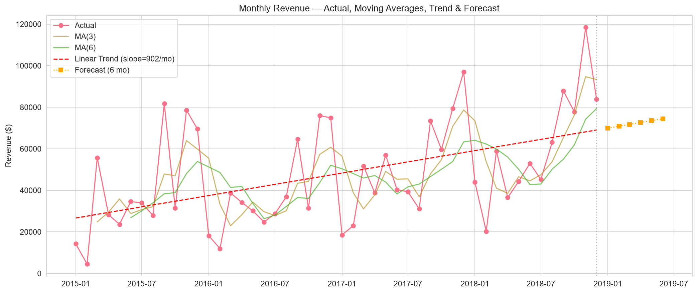
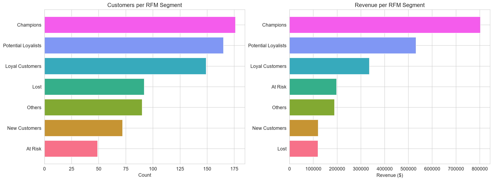
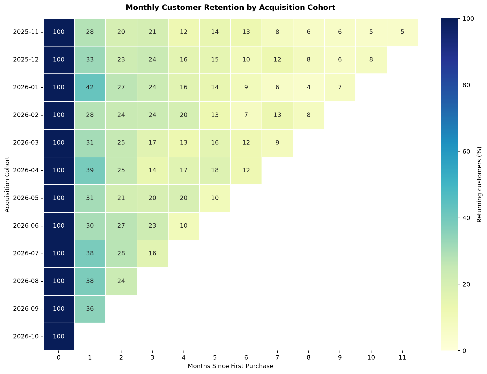

# Daniil Marchenko — Junior Data Analyst Portfolio

**Kyiv, Ukraine (GMT+2) · English B2 · B.Sc. Digital Economics (2nd year)**
[LinkedIn](https://www.linkedin.com/in/daniil-marchenko-7660203b6/) · [GitHub](https://github.com/pricenly) · [Email](mailto:beshary47@gmail.com) · +380 67 110 9366

I am looking for a **Junior Data Analyst / Analytics Intern** role (remote or hybrid).
This repository is my working evidence: four small, reproducible projects built with SQL, Python and BI tooling.

The point of each project is not the chart — it is the question, the cleaning decisions, and the limits of what the data can support.

---

## Projects at a glance

| # | Project | Business question | Stack | Evidence |
|---|---------|-------------------|-------|----------|
| 1 | [Superstore EDA, RFM & Forecast](./superstore-analytics) | Where does revenue come from, which segments are worth keeping, and what does the next 6 months look like? | Python, pandas, seaborn, scikit-learn | 9 charts, 7 exported tables, real Kaggle dataset |
| 2 | [E-Commerce SQL Analytics](./sql-ecomm-funnel) | How large is recorded revenue reversal, which SKUs drive it, and how do cohorts retain? | PostgreSQL, CTEs, window functions | 9 documented query sections |
| 3 | [Cohort Retention Pipeline](./cohort-retention-analysis) | How do you compute retention correctly, with validation and explicit limits? | Python, pandas, matplotlib | Automated pipeline, quality report, heatmap |
| 4 | [Marketing ROI Dashboard Spec](./tableau-marketing-roi) | Which paid channels pay back, and what happens if we move budget? | Tableau calculated fields, synthetic data generator | Field-by-field dashboard specification |

> **Data honesty:** Project 1 uses the public Kaggle *Sample Superstore* dataset (real records).
> Projects 3 and 4 use **synthetic** data and are labelled as such — they demonstrate method, not company results.
> Project 2 ships the queries and loader; the UCI dataset itself is downloaded by the reader.

---

## 1. Superstore: EDA, RFM segmentation and a 6-month forecast

**Question:** a US retailer has four years of orders. Where is profit actually made, which customers carry it, and what is a defensible short-term forecast?

**What I did**

- Profiled 10,800 raw rows: found 806 empty rows (the appended Returns block) and 504 exact duplicates, and excluded them explicitly instead of silently dropping them.
- Checked date order, negative sales, quantity, discount range and IQR outliers; kept outliers but flagged them, because a large order is not automatically an error.
- Built the EDA: revenue, profit and margin by month, category, sub-category, state, region, segment and ship mode.
- Scored every customer with quartile RFM and mapped them to 7 segments; measured **observed historical revenue per customer** (not a predicted CLV).
- Forecast the next 6 months with a moving average and a linear trend, and stated that the trend line is a baseline, not a business plan.

**Results (real data, 2015–2018)**

| Metric | Value |
|---|---|
| Revenue / profit / margin | $2.30M / $286K / 12.5% |
| Customers / orders / AOV | 793 / 5,009 / $459 |
| Top category | Technology — $836K |
| Best sub-category margin (≥10 orders) | Labels — 44.4% |
| Worst sub-category margin | Tables — −8.6% |
| Best region by revenue | West — $725K |
| Champions | 176 customers = **35% of revenue** |
| Month-1 / month-3 retention | 12.1% / 15.0% |
| Next 6 months (linear baseline) | ≈ $433K |

**What I would tell the business:** protect the Champions segment, review pricing and supplier terms for Tables, and treat the forecast as a floor-level baseline rather than a target.





Files: [`eda_notebook.py`](./superstore-analytics/eda_notebook.py) · [`README.md`](./superstore-analytics/README.md) — the run also writes `output/key_insights.md` and the exported tables locally.

---

## 2. E-Commerce SQL Analytics

**Question:** the UCI Online Retail II dataset records completed invoices, cancellations and returns. What can be measured without pretending it is a website funnel?

**What I did**

- Wrote 9 sections of PostgreSQL: data-quality checks, an invoice-quality funnel proxy, revenue reversals by type and SKU, monthly trends, cohort retention, RFM, cumulative LTV, product reorder rates, and country ARPU.
- Used `LAG`, `FIRST_VALUE`, `NTILE`, `RANK`, `DENSE_RANK` and cumulative `SUM() OVER (...)`.
- Documented what the data **cannot** answer: there are no cart, checkout or session events, so the output must not be called a conversion or abandonment rate.

📁 [`analysis.sql`](./sql-ecomm-funnel/analysis.sql) · [`load_data.sql`](./sql-ecomm-funnel/load_data.sql) · [`load_data.py`](./sql-ecomm-funnel/load_data.py) · [`README.md`](./sql-ecomm-funnel/README.md)

---

## 3. Cohort Retention Pipeline (synthetic data)

**Question:** how do you compute monthly retention so the number is defensible?

**What I did**

- Generated a reproducible 12-month synthetic transaction set with a fixed seed.
- Validated the input: required columns, date parsing, duplicates, blank users, non-positive revenue, IQR outliers (flagged, not deleted).
- Computed month-0…month-11 retention, wrote the matrix to CSV, and rendered an annotated heatmap.
- Separated "empty cell" from "0% retention" and wrote down the limitations of the method.

Synthetic result: month-1 retention lands between 27.8% and 42.4% across cohorts — a property of the generator, not a market benchmark.



📁 [`cohort_analysis.py`](./cohort-retention-analysis/cohort_analysis.py) · [`generate_cohort_data.py`](./cohort-retention-analysis/generate_cohort_data.py) · [`README.md`](./cohort-retention-analysis/README.md)

---

## 4. Marketing ROI Dashboard Specification (Tableau)

**Question:** which acquisition channels pay back, and how sensitive is revenue to a budget shift?

This project is a **specification**, not a published workbook: the data generator, the field definitions and the page-by-page design are here, and the workbook is built from them.

- 5 channels, daily spend, attributed orders and customer-level lifetime revenue, generated reproducibly.
- Calculated-field library: blended ROAS/CAC, payback months, `{FIXED}` cohort month, retention and cumulative LTV, scenario projection with per-channel elasticity.
- Documented assumptions, including that elasticity values are illustrative inputs, not estimates.

📁 [`generate_data.py`](./tableau-marketing-roi/generate_data.py) · [`calculated_fields.md`](./tableau-marketing-roi/calculated_fields.md) · [`README.md`](./tableau-marketing-roi/README.md)

---

## Skills, with the evidence

| Skill | Where it is used |
|---|---|
| SQL: CTEs, window functions, cohort logic | `sql-ecomm-funnel/analysis.sql` |
| Python: pandas cleaning, validation, groupby, merge | `superstore-analytics/eda_notebook.py` |
| Visualisation: matplotlib / seaborn | 10 committed charts across projects 1 and 3 |
| Statistics: quartiles, IQR, moving averages, OLS trend | `eda_notebook.py` |
| BI modelling: LOD, table calculations, parameters | `tableau-marketing-roi/calculated_fields.md` |
| Reproducibility: seeds, CLI arguments, quality reports | `cohort-retention-analysis/` |

---

## Run it yourself

```bash
# Project 1 — real dataset is bundled
cd superstore-analytics
pip install -r requirements.txt
python eda_notebook.py          # writes images/ and output/

# Project 3 — fully synthetic, no downloads
cd ../cohort-retention-analysis
pip install -r requirements.txt
python generate_cohort_data.py
python cohort_analysis.py

# Project 4 — generates the Tableau source CSVs
cd ../tableau-marketing-roi
python generate_data.py
```

Project 2 needs PostgreSQL and the UCI dataset; see [`sql-ecomm-funnel/README.md`](./sql-ecomm-funnel/README.md).

---

## Availability

- **Target roles:** Junior Data Analyst, Analytics Intern, Business Analyst (trainee)
- **Format:** full-time or part-time, remote / hybrid / Kyiv office
- **Languages:** Ukrainian (native), English (B2), Russian (native)

📧 [beshary47@gmail.com](mailto:beshary47@gmail.com) · 📱 +380 67 110 9366
